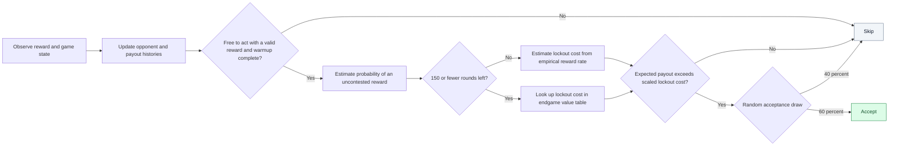

# G-Research Trading Game

### Top 3 team finish · Online opponent learning · Dynamic programming

Our team placed **top 3 in the G-Research Trading Game**. This repository presents an adaptive model for competitive reward selection: learn how opponents behave, estimate the chance of collecting each reward, and balance its expected payout against the cost of a lockout.

> **The idea:** a reward's face value is only part of the decision. What matters is how much we expect to collect—and which future opportunities we give up to pursue it.

[The game](#the-game) · [Model overview](#model-overview) · [The mathematics](#the-mathematics) · [Implementation](#implementation) · [Setup and usage](#trading-game-client)

## The game

Each round presents a shared reward. Teams independently choose whether to accept it. Accepting triggers a lockout—even if another team accepts too and causes a collision.

| Reward distribution | Game length | Default lockout | Collision outcome |
|:---|:---|:---|:---|
| Exponential, mean **10** | **2,000 rounds** | **15 rounds** | No payout; all accepting teams locked out |

Under these Round 3 rules, a smaller reward can be more attractive if it is likely to go uncontested.

## Model overview



The model keeps learning throughout the game, including while locked out:

1. **Learn opponents.** Infer accept/pass decisions from score and lockout changes, building a history for each team.
2. **Estimate the payout.** Use those histories and estimated opponent availability to predict whether a reward will go uncontested.
3. **Price the wait.** Estimate the score sacrificed during a lockout, switching to a finite-horizon dynamic program for the final **150 rounds**.
4. **Vary the decisions.** Randomize qualifying accepts to reduce repeated collisions between similar strategies.

## The mathematics

### Reward value after accounting for competition

Let $\widehat p_j(r)$ be opponent $j$'s estimated probability of accepting reward $r$, and $f_j$ its estimated probability of being free to act. Approximating opponents' choices as independent gives:

$$
\boxed{\widehat u(r) = r\prod_j\left(1-f_j\widehat p_j(r)\right)}.
$$

This is the reward multiplied by the estimated probability that nobody else accepts. The acceptance estimates combine observed choices with a single-player threshold prior, so the model can act before it has much evidence about an opponent.

### The cost of accepting

During the main part of the game, the model estimates an achievable score rate from historical rewards that appeared uncontested. Multiplying that rate by the lockout length gives the opportunity cost $C$.

Near the end, the remaining time matters more. With $n$ rounds left and a lockout of $L$ rounds, the dynamic program uses:

$$
\boxed{C_n = V_{n-1} - V_{\max(n-1-L,\,0)}}.
$$

Here, $V_n$ is the expected future score in a model built from historical payout samples. The threshold measures the future value lost by accepting now. On the final round, $C_1=0$: there are no later opportunities to sacrifice.

### The decision rule

After **10 resolved observations**, an available team with a positive finite reward considers accepting when:

$$
\boxed{\widehat u(r) > sC}, \qquad s\sim\mathrm{Uniform}(0.85,1.15).
$$

The multiplier $s$ is drawn once per game; $C_n$ replaces $C$ in the endgame. A qualifying reward is then accepted with **60% probability**, introducing variation between otherwise similar decisions.

The estimates rely on inferred actions and approximate independence. Delayed lockout flags or correlated opponents can make them inaccurate; the model is a practical heuristic for the multiplayer game.

## Implementation

| File | Role |
|:---|:---|
| [`solution_round3_learning.py`](solution_round3_learning.py) | Adaptive opponent-learning model described above |
| [`solution.py`](solution.py) | Simpler threshold-based baseline, currently used by the test and submission scripts |

To use the adaptive model with those scripts, copy its implementation into `solution.py`. The repository does not include a comparative performance benchmark between the two strategies.

Built on the [original participant client](https://github.com/ajaykm3/gr_tradinggame_client). Its README is preserved below.

---

# Trading Game Client

## Setup

Use Python 3.11 or newer and `uv`.

```bash
git clone <this-repo>
cd gr_tradinggame_client
uv sync --python 3.11
```

## Usage

### 1. Edit `solution.py`

Write your strategy in the `play` function or class method:

```python
class Solution:
    def __init__(self):
        self.history = []

    def play(self, reward: float, lockout: int, t: int, T: int, your_score: float, other_scores: list[tuple[float, bool]], is_locked: bool) -> bool:
        self.history.append(reward)
        if is_locked:
            return False
        return reward > 14.0

play = Solution().play
```

Your function is called every round (including while locked out). Returning `True` while locked out has no effect but you still observe the reward and the state of the game.

### 2. Test locally

```bash
uv run python test.py
```

Checks your function handles edge cases and runs fast enough, including a game-like check (2000 rounds, 23 other teams) that must average under 15 ms per round. On the server, a team that uses more than 60 s in one game is benched for the rest of that game.

The server has numpy, pandas and the Python standard library. Other packages are not available there, even if you install them locally.

### 3. Submit

Edit `config.py` with your team name, password, and server address, then:

```bash
uv run python submit.py
```

You can resubmit as many times as you want. The server uses your latest submission.

### Password

Your password is set on your first submission. All future submissions for that team name must use the same password. Choose anything you like, just don't forget it.

## Parameters

| Parameter | Type | Description |
|---|---|---|
| `reward` | `float` | The reward offered this round |
| `lockout` | `int` | Rounds locked out if you accept |
| `t` | `int` | Current round number, 1 to T |
| `T` | `int` | Total rounds |
| `your_score` | `float` | Your cumulative score so far at round $t-1$ |
| `other_scores` | `list[tuple[float, bool]]` | List of `(score, is_locked)` tuples for other teams at round $t-1$ (empty `[]` on round 1) |
| `is_locked` | `bool` | Whether you are currently locked out this round |
