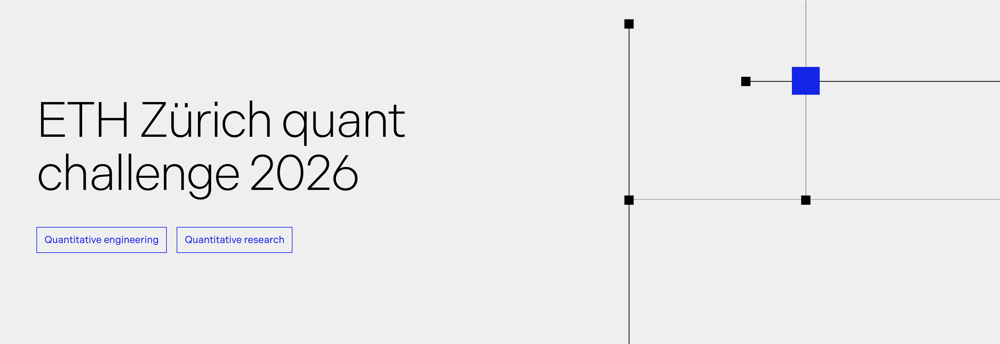
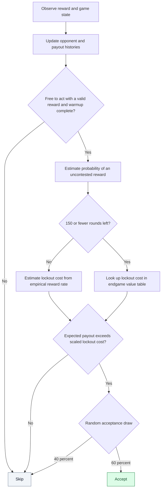

# G-Research Trading Game

### Top 3 team finish · Online opponent learning · Dynamic programming

Our team placed **top 3 in the G-Research Trading Game**. This repository presents an adaptive model for competitive reward selection: learn how opponents behave, estimate the chance of collecting each reward, and balance its expected payout against the cost of a lockout.

> **The idea:** a reward's face value is only part of the decision. What matters is how much we expect to collect—and which future opportunities we give up to pursue it.

[The game](#the-game) · [Model overview](#model-overview) · [The mathematics](#the-mathematics) · [Implementation](#implementation) · [Setup and usage](#trading-game-client)

## The game

Each round presents a shared reward. Teams independently choose whether to accept it. Accepting commits a team to a period of inactivity, even if another team accepts too and causes a collision.

| Reward model | Game length | Default lockout | Collision rule |
|:---|:---|:---|:---|
| Exponential, mean **10** | **2,000** rounds | **15** rounds | Multiple accepts: no payout, all accepting teams locked out |

These are the Round 3 rules targeted by the model. A successful decision must account for both **competition now** and **opportunity cost later**.

## Model overview

The adaptive strategy in [`solution_round3_learning.py`](solution_round3_learning.py) updates its view of opponents throughout the game, including during its own lockout periods.

1. **Observe.** Use changes in opponents' scores and lockout states to infer past accept/pass decisions.
2. **Estimate.** Learn how likely each opponent is to accept the current reward and estimate the chance that nobody else takes it.
3. **Value.** Compare the expected payout with the future score sacrificed during a lockout.
4. **Act.** Randomize qualifying decisions to reduce collisions between teams following similar rules.



## The mathematics

### 1. Learn each opponent's acceptance behavior

For opponent $j$ and a candidate reward $r$, count two kinds of evidence:

- $A_j(r)$: observed accepts at rewards **at or below** $r$.
- $B_j(r)$: observed passes at rewards **at or above** $r$.

An accept at a smaller reward supports accepting $r$; a pass at a larger reward supports passing on $r$. One additional prior observation anchors the estimate to a single-player threshold $c_0$:

$$
\boxed{
\widehat p_j(r)
= \frac{A_j(r) + \mathbf{1}\{r > c_0\}}
       {A_j(r) + B_j(r) + 1}
}.
$$

Here, $\mathbf{1}\{\cdot\}$ is 1 when its condition holds and 0 otherwise. Before any observations, the opponent is modeled as accepting above $c_0$ and passing below it.

The prior starts from a single-player exponential-reward threshold and is reduced near the end of the game. Accept/pass histories are inferred from lockout transitions; score changes provide evidence about whether those flags describe the current or previous round.

### 2. Discount rewards for collision risk

Let $f_j$ be the estimated probability that opponent $j$ is currently free to act. Using a product approximation across opponents, the probability of an uncontested reward is:

$$
\widehat q(r)
= \prod_j \left(1 - f_j\widehat p_j(r)\right).
$$

The reward's estimated collectible value is therefore:

$$
\boxed{\widehat u(r) = r\,\widehat q(r)}.
$$

A large reward may have a low expected payout if it attracts several opponents. A smaller reward can be more attractive when it is likely to go uncontested.

### 3. Estimate the cost of a lockout

For each resolved historical round, construct an inferred payout sample:

$$
x_i =
\begin{cases}
 r_i, & \text{if no opponent was inferred to accept}, \\
 0, & \text{otherwise}.
\end{cases}
$$

These samples approximate what accepting those rewards would have paid before accounting for our own availability. Sort the $m$ samples in descending order, so $x_{(1)} \geq \cdots \geq x_{(m)}$.

For a policy targeting the top $k$ samples, estimate the score earned per round, including the lockout time. With lockout length $L$:

$$
\widehat g
= \max_{1 \leq k \leq m}
\frac{\sum_{i=1}^{k} x_{(i)}}{m + Lk}.
$$

The midgame opportunity-cost threshold is:

$$
\boxed{C = L\widehat g}.
$$

This translates a lockout into the estimated score forgone during those $L$ rounds. The estimate updates as new payout samples arrive.

### 4. Adjust for the remaining horizon

During the final **150 rounds**, the model replaces the long-run rate estimate with a dynamic program over the empirical payout samples.

Let $V_n$ be the value in this empirical model when free to act with $n$ rounds remaining. The lockout cost is the difference between the future value after skipping and after accepting:

$$
C_n = V_{n-1} - V_{\max(n-1-L,\,0)}.
$$

Starting from $V_0 = 0$, compute:

$$
\boxed{
V_n = V_{n-1}
+ \frac{1}{m}\sum_{i=1}^{m}\max(x_i-C_n,\,0)
}.
$$

The table is built from the samples available when the endgame calculation first runs and is reused for that lockout length. On the final round, $C_1 = 0$: there are no future opportunities to sacrifice.

### 5. Randomize qualifying decisions

Teams using the same deterministic rule can repeatedly choose the same rewards. The model introduces two sources of variation:

| Mechanism | Setting | Purpose |
|:---|:---|:---|
| Per-game threshold multiplier | $s \sim \mathrm{Uniform}(0.85, 1.15)$ | Vary the acceptance threshold across games |
| Per-decision acceptance draw | $U \sim \mathrm{Uniform}(0, 1)$ | Accept a qualifying reward with probability 0.6 |

Once free to act, with a positive finite reward and at least **10 resolved payout samples**, the decision rule is:

$$
\boxed{
\text{accept}
\iff
r\,\widehat q(r) > sC
\quad\text{and}\quad
U < 0.6
}.
$$

In the endgame, $C_n$ replaces $C$.

## Implementation

| File | Role |
|:---|:---|
| [`solution_round3_learning.py`](solution_round3_learning.py) | Adaptive opponent-learning model described above |
| [`solution.py`](solution.py) | Simpler baseline using a single-player threshold and a fixed acceptance band |
| [`test.py`](test.py) | Client interface and runtime checks |
| [`submit.py`](submit.py) | Submission of the strategy in `solution.py` |

**Entry point:** the existing test and submission scripts still load `solution.py`. To use the adaptive model with those scripts, place its implementation in `solution.py` first.

### Modeling assumptions

The acceptance estimates are heuristics based on inferred actions. They assume threshold-like opponent behavior, while the product estimate of an uncontested reward approximates opponents' choices as independent. Delayed lockout flags and correlated strategies can make those estimates inaccurate.

The endgame recurrence solves the empirical payout model; it does not solve the full multiplayer game. The repository does not include a comparative benchmark between the adaptive model and the baseline.

## Attribution and original client documentation

Built on the [G-Research Trading Game participant client](https://github.com/ajaykm3/gr_tradinggame_client). The client library and submission infrastructure come from that project; the strategy implementations are in `solution.py` and `solution_round3_learning.py`.

The original client README is preserved below, including setup, testing, submission, and the strategy interface.

---

# Trading Game Client

## Setup

Use Python 3.11 or newer and `uv`.

```bash
git clone <this-repo>
cd gr_tradinggame_client
uv sync --python 3.11
```

## Usage

### 1. Edit `solution.py`

Write your strategy in the `play` function or class method:

```python
class Solution:
    def __init__(self):
        self.history = []

    def play(self, reward: float, lockout: int, t: int, T: int, your_score: float, other_scores: list[tuple[float, bool]], is_locked: bool) -> bool:
        self.history.append(reward)
        if is_locked:
            return False
        return reward > 14.0

play = Solution().play
```

Your function is called every round (including while locked out). Returning `True` while locked out has no effect but you still observe the reward and the state of the game.

### 2. Test locally

```bash
uv run python test.py
```

Checks your function handles edge cases and runs fast enough, including a game-like check (2000 rounds, 23 other teams) that must average under 15 ms per round. On the server, a team that uses more than 60 s in one game is benched for the rest of that game.

The server has numpy, pandas and the Python standard library. Other packages are not available there, even if you install them locally.

### 3. Submit

Edit `config.py` with your team name, password, and server address, then:

```bash
uv run python submit.py
```

You can resubmit as many times as you want. The server uses your latest submission.

### Password

Your password is set on your first submission. All future submissions for that team name must use the same password. Choose anything you like, just don't forget it.

## Parameters

| Parameter | Type | Description |
|---|---|---|
| `reward` | `float` | The reward offered this round |
| `lockout` | `int` | Rounds locked out if you accept |
| `t` | `int` | Current round number, 1 to T |
| `T` | `int` | Total rounds |
| `your_score` | `float` | Your cumulative score so far at round $t-1$ |
| `other_scores` | `list[tuple[float, bool]]` | List of `(score, is_locked)` tuples for other teams at round $t-1$ (empty `[]` on round 1) |
| `is_locked` | `bool` | Whether you are currently locked out this round |
